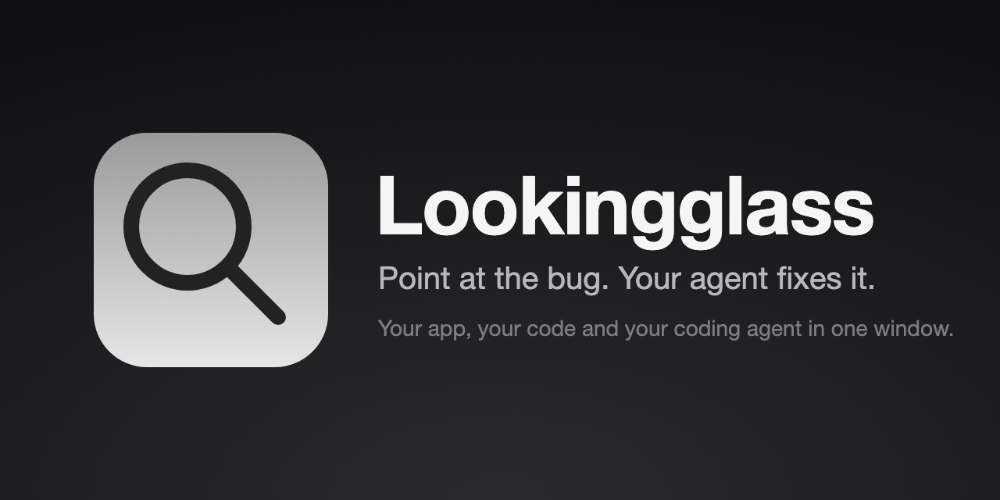
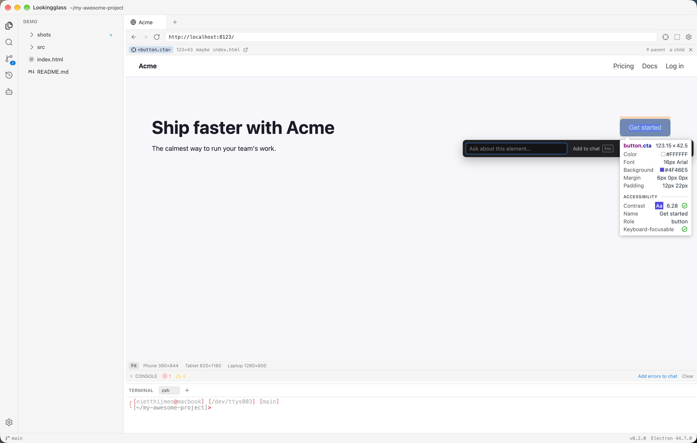
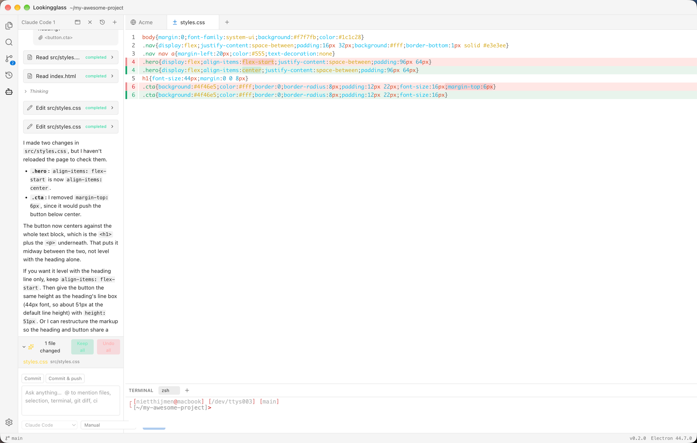
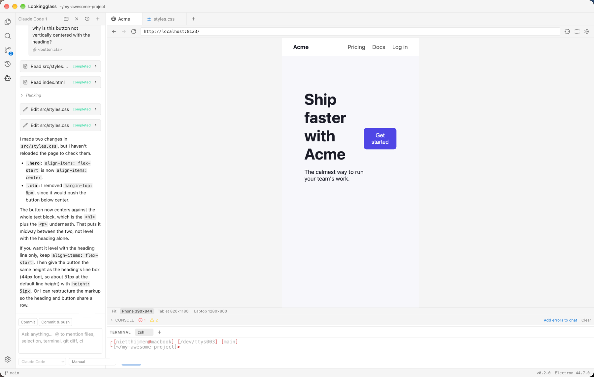

<p align="center">
  
</p>

<h1 align="center">🔭 Lookingglass</h1>

<p align="center">
  <strong>Point at the bug. Your agent fixes it.</strong><br>
  A desktop editor where your app, your code and your coding agent live in one window.
</p>

<p align="center">
  <a href="https://github.com/NietThijmen/looking-glass/releases">Download</a> ·
  <a href="docs/installation.md">Install</a> ·
  <a href="docs/setup.md">Set up</a> ·
  <a href="docs/usage.md">Use</a> ·
  <a href="docs/design.md">Design notes</a>
</p>

Coding agents are great at code and blind to the UI. Lookingglass gives them eyes.

Run your dev server, open it in the built-in browser, click the button that looks wrong and ask. The agent gets the element's HTML, styles, a screenshot and the **source file that rendered it**. It edits the code, HMR reloads, it takes its own screenshot to check, and you review the result hunk by hunk.

## ✨ Why you'll like it

- 🎯 **Point, don't describe.** Pick an element and the agent sees what you see: markup, matched CSS rules, computed styles, accessibility info and a screenshot.
- 📍 **From pixel to file.** `src/components/Hero.tsx:42`, found through React, Vue and Svelte dev metadata, source maps and search.
- 🤖 **The agent checks its own work.** It can click, type, resize to a phone viewport, read the console and screenshot, so "fix it and verify" is one turn.
- 🔑 **Bring your own agent.** No new account, no proxied keys. Claude Code works out of the box; Codex, Gemini CLI or any [ACP](https://agentclientprotocol.com) agent plug in with a few lines of JSON.
- 🧐 **Review before you keep.** Keep or undo every hunk. Every message takes a checkpoint, so one click rolls everything back, even outside git.
- ↗️ **Hand off to your own editor.** One click opens the file at the right line in VS Code, Cursor, Windsurf or a JetBrains IDE.
- 🛠️ **A real editor around it.** File tree, search, git, diagnostics and a terminal. You can work without the agent too.

## 🚀 Quick start

1. **Download** the installer for your OS from [Releases](https://github.com/NietThijmen/looking-glass/releases) (macOS `.dmg`, Windows installer, Linux AppImage).
2. **Log in** to Claude Code: run `claude` once in a terminal, or set `ANTHROPIC_API_KEY`.
3. **Open your project** with `⌘O`, start your dev server in the terminal (`` ⌃` ``) and open the URL it prints.
4. **Pick an element** with `⌘⇧C`, type your question, press `Enter`.

Details: [Installation](docs/installation.md) · [Setup](docs/setup.md) · [Usage guide](docs/usage.md)

## 🎬 See it in action

**Pick an element and ask.** The agent gets the markup, styles, a screenshot and the source file.



**Review what the agent changed**, hunk by hunk, and keep or undo it.



**Check it at any size**, with device presets and a console that can feed straight into chat.



## 📚 Documentation

| Guide                                | What's in it                                                             |
| ------------------------------------ | ------------------------------------------------------------------------ |
| [Installation](docs/installation.md) | Installers, first launch, building from source, updates, troubleshooting |
| [Setup](docs/setup.md)               | Agents, per-project settings, MCP servers, shortcuts, source mapping     |
| [Usage](docs/usage.md)               | The picker, chat, @-mentions, reviewing edits, the editor, the terminal  |
| [Design notes](docs/design.md)       | Architecture, ACP integration, security model, roadmap                   |

## 🔒 Privacy and safety

- Agents run as separate processes, and every file path they use is confined to the open folder.
- Picked elements, screenshots and console output go to the agent you're chatting with, and so to its model provider. Check the chip before sending.
- The built-in browser has its own profile. Agents can browse `localhost` freely; going elsewhere or running JavaScript in the page asks you first.
- Lookingglass stores no credentials. Logins stay in each agent's own config.

## 🧑‍💻 Development

Requires Node 24+ and pnpm 11.

```bash
pnpm install
pnpm dev       # run the app with hot reload
pnpm check     # typecheck + lint + prettier + unit tests
pnpm smoke     # build and drive the real app against a throwaway repo
pnpm package   # installers for your platform
```

Built with Electron, React and TypeScript. See [docs/installation.md](docs/installation.md#build-from-source) for more.

## 🔗 Links

[Agent Client Protocol](https://agentclientprotocol.com) · [ACP adapters and SDKs](https://github.com/agentclientprotocol) · [Model Context Protocol](https://modelcontextprotocol.io)
