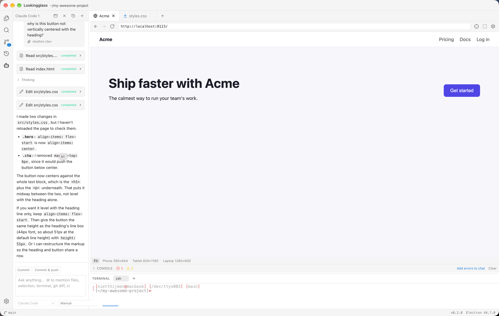
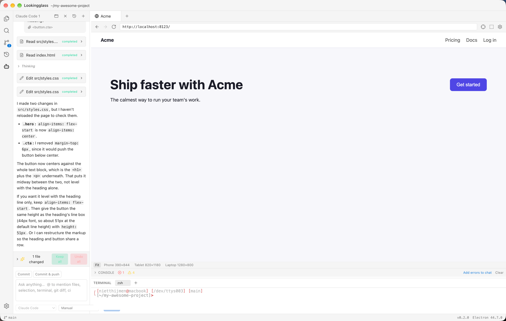
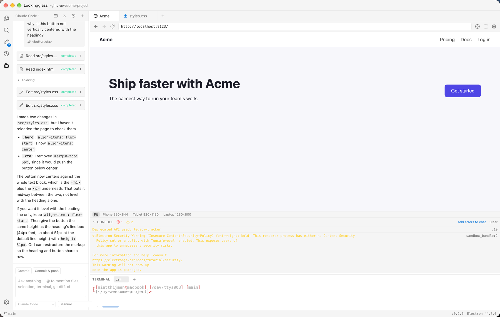
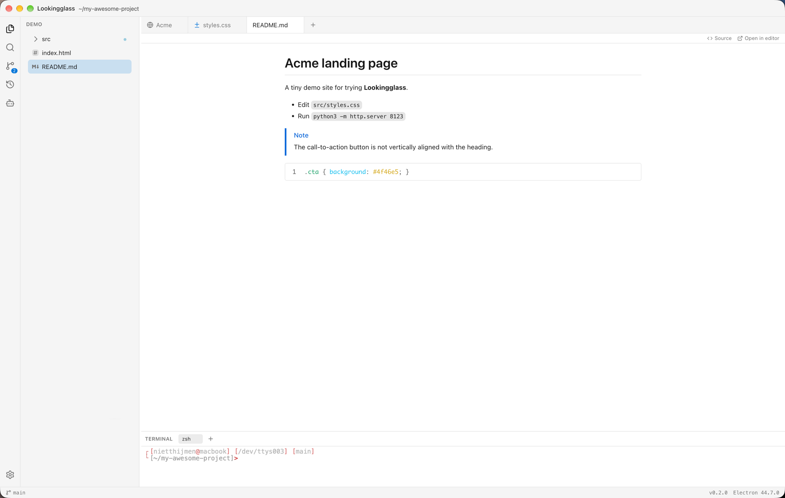

# Usage

A tour of a typical session. Assumes you've [installed](installation.md) the app and [set up](setup.md) an agent.

## 1. Open your project

`⌘O` opens a folder. Start your dev server in the terminal (`` ⌃` ``). When something like `Local: http://localhost:5173` appears, Lookingglass offers to open it in a browser tab. You can also open one yourself with `⌘⇧B`, or set `previewUrl` in [project settings](setup.md#per-project-settings).



Browser tabs sit next to your code tabs. They have an address bar, DevTools and **device presets** (phone, tablet, desktop or a custom size).


## 2. Point at something

Press `⌘⇧C` to start the element picker.


- **Hover** to highlight elements, DevTools-style.
- **Click** to pick one, **Shift+click** to pick several.
- Walk to the **parent or child** of the picked element.
- **Drag** to capture a region instead.

An **Ask about this element…** popover appears:

| Key      | Does                                           |
| -------- | ---------------------------------------------- |
| `Enter`  | Ask the active chat                            |
| `⌘Enter` | Start a new chat with the question             |
| `Esc`    | Add the element to your chat message as a chip |

The chip shows exactly what will be sent: HTML, matched CSS rules, computed styles, accessible name and role, a screenshot and the source location (like `Hero.tsx:42`). Untick anything you don't want to share.

## 3. Chat with the agent

- Replies stream in, with thinking, tool calls as collapsible cards and plans as a live checklist.
- Reads and searches are allowed automatically. Edits and commands ask for permission.
- Run several chats at once, each with its own agent. Switch agent modes (like plan mode) when the agent offers them, and resume earlier chats from history.
- Paste or drop images straight into the message box.



### @-mentions

| Mention            | Adds                                    |
| ------------------ | --------------------------------------- |
| `@file`, `@folder` | A file or folder from your project      |
| `@selection`       | The code selected in the editor         |
| `@terminal`        | Recent terminal output                  |
| `@git-diff`        | Your uncommitted changes                |
| `@problems`        | Current TypeScript diagnostics          |
| `@browser`         | Screenshot and URL of the open page     |
| `@browser-console` | Console output, errors, failed requests |

### Saved prompts

Save prompts you re-use under **Settings → Prompts**, then run them from the message box with `!`. Typing `!` lists your prompts; `Enter` or `Tab` picks one. For example, a prompt named `release`:

```text
Bump the version, update the changelog, tag it and push.
```

Type `!release` and send, or pick it from the list to read and edit the text first.

Everything after `!name` on the same line is the prompt's arguments. Use them in the prompt text with:

| Placeholder  | Filled with                                                 |
| ------------ | ----------------------------------------------------------- |
| `$1` … `$9`  | The first to ninth argument (`"double quotes"` group words) |
| `$ARGUMENTS` | Everything after the name                                   |

A prompt named `deploy` with the text `Deploy $1 to $2 and check the logs.` runs as `!deploy api staging`. If a prompt has no placeholders, the arguments are added to the end of its text, so `!release 1.4.0` sends "Bump the version, … and push. 1.4.0". Picking a prompt that has placeholders from the list leaves `!deploy ` in the box for you to add the arguments.

### The agent can use the browser too

Every agent gets browser tools over MCP. It can snapshot the page, click, type, resize to a phone viewport, read the console and take screenshots. So "fix the layout on mobile and check it" works in one turn.

Agents can browse `localhost` and your preview URL freely. Navigating elsewhere or running JavaScript in the page asks you first.

## 4. Review what changed

Agent edits are written to disk right away, so your dev server, HMR and tests see them. Meanwhile:


- A **changes bar** and a **review tab** list every changed file with **Keep** / **Undo** per hunk, or **Keep all** / **Undo all**.
- A **checkpoint** is taken before every message. Hover a message and click **Restore** to roll all files back to that moment. It works in folders that aren't git repos and never touches your own `.git`.

### Inline edit

Select code, press `⌘K`, describe the change. The result opens in review.

## 5. Console

The console panel under the browser shows console output, uncaught exceptions and failed network requests. Send any entry to the chat, or mention `@browser-console`.



## 6. Open in your own editor

Prefer VS Code, Cursor or a JetBrains IDE for the actual typing? Click the **↗ Open in editor** button to jump to the file there, at the right line. You'll find it:

- in the **editor tab toolbar**, which opens the current file at your selection (or the cursor line),
- next to the **source location** of a picked element in the browser's picker bar, which opens the component that rendered it,
- next to **file locations in agent tool calls** in the chat.

Pick which editor it uses in **Settings → Open in editor** ([setup](setup.md#open-in-editor)).

## 7. The editor around it

You can work without an agent:

- File tree, tabs and syntax highlighting
- Project search (`⌘⇧F`, powered by ripgrep)
- TypeScript diagnostics
- Git: status, diffs, a commits view, commit and push (`⌃⇧G`, `⌃⇧H`)
- **Markdown preview**: on `.md`, `.markdown` and `.mdx` files, the **Preview** button in the tab toolbar shows the rendered document (GitHub-style, including alerts). It follows your unsaved edits, and **Source** switches back.
- Integrated terminal. Commands the agent runs open as terminal tabs you can watch and kill.



## Tips

- Pick the element _and_ describe the intent: "make this match the spacing of the card above" beats "fix this".
- Pages you're logged into can contain personal data. Check the chip before sending.
- Use plan mode for big changes, then review hunk by hunk.
